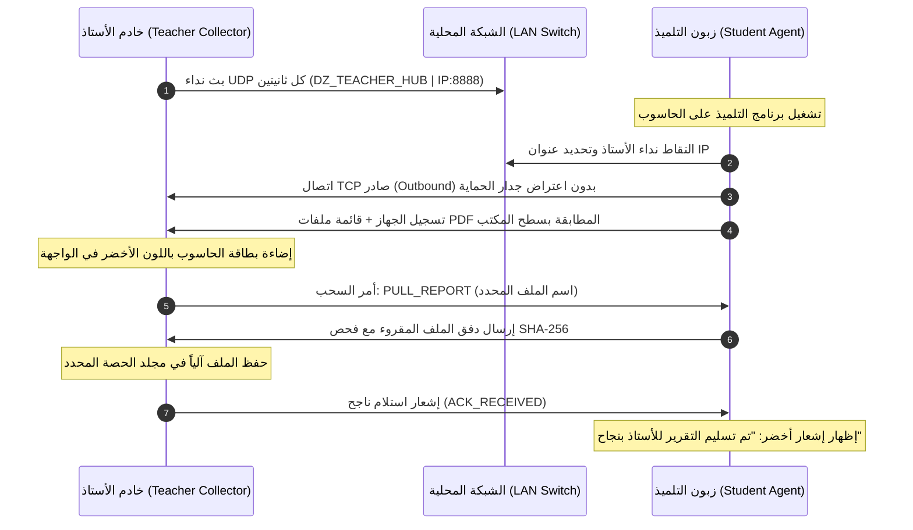

# الدراسة المعمارية والتخطيطية الشاملة لنظام جمع تقارير التقييم عبر الشبكة المحلية (LAN)
### (نظام الخادم والزبون: خادم الأستاذ المستمع + زبون التلميذ الذاتي)

---

## 1. ملخص المشروع والأهداف البيداغوجية والتقنية

يهدف هذا المشروع إلى تزويد أساتذة مادة المعلوماتية بحل شبكي مستقل، محمول، وفائق الخفة لجمع ملفات تقارير التقييم (`.pdf`) آلياً من أسطح مكاتب حواسيب مخبر المعلوماتية، مع تنظيمها تلقائياً في مجلدات مصنفة حسب **الفوج**، **تاريخ الحصة**، و**فترة الحصة التلقائية** (صباحية أو مسائية وفق المنهاج والتوقيت الجزائري).

### الأهداف الأساسية:
1. **الاستقلالية التامة وعدم طلب أي مكتبات خارجية (Zero Dependencies):**
   - يعمل على حواسيب المخبر المتواضعة (Dual Core, Celeron, 2GB RAM) دون الحاجة لتنصيب Node.js، Python، أو أطر عمل إضافية.
2. **التوافق الشامل مع كافة إصدارات ويندوز (Windows 7 SP1, 8, 8.1, 10, 11 - 32-bit & 64-bit).**
3. **العمل دون إنترنت بنسبة 100%:** عبر سويتش محلي مغلق (LAN Switch / Wi-Fi Router).
4. **التخطي الآلي لجدار حماية ويندوز (Windows Firewall Bypassing by Design):** دون الحاجة لصلاحيات المسؤول (Admin) على أجهزة التلاميذ.
5. **فرز وترتيب بيداغوجي ذكي:** إنشاء شجرة مجلدات تلقائية بحسب فترة الحصة دون أي تدخل يدوي من الأستاذ.

---

## 2. دراسة المقارنة التقنية لاختيار البيئة (Technology Stack Benchmark)

لتحقيق شرط «برنامجان محمولان خفيفان لا يحتاجان لأي مكتبات إضافية ويعملان على أضعف الحواسيب»، تم إجراء مقارنة تقنية دقيقة بين أربعة خيارات:

| المعيار | Electron / Web | Python (PyInstaller) | Go / Rust | **C# .NET 4.0 الأصيل (عبر csc.exe المدمج)** |
| :--- | :--- | :--- | :--- | :--- |
| **حجم الملف التنفيذي** | ~120 MB | ~20 - 35 MB | ~8 - 15 MB | **~80 KB - 180 KB فقط!** 🏆 |
| **استهلاك الذاكرة (RAM)** | ~90 - 140 MB | ~45 - 60 MB | ~15 - 25 MB | **~8 - 14 MB فقط!** 🏆 |
| **المكتبات المطلوبة** | حزمة كاملة | محرك بايثون مدمج | صفر (لكن يتطلب مترجم خارجي) | **صفر! مدمج في نواة كل ويندوز منذ Win 7** 🏆 |
| **الترجمة على حاسوبك** | يتطلب node | يتطلب python | غير مثبت حالياً | **جاهز فوراً عبر مترجم ويندوز الرسمي `csc.exe`** 🏆 |
| **واجهة المستخدم** | HTML/CSS | Tkinter (ثقيلة) | Win32 عارية | **Windows Forms عربية RTL أصلية وسريعة** 🏆 |

> [!IMPORTANT]
> **القرار التقني المعتمد:**
> استخدام **C# النقي الموجه لإطار عمل .NET Framework 4.0** عبر مترجم ويندوز الأصيل `C:\Windows\Microsoft.NET\Framework\v4.0.30319\csc.exe`.
> هذا الخيار ينتج ملفاً تنفيذياً حقيقياً بحجم أقل من **150 كيلوبايت**، يعمل نقراً مباشراً دون تنصيب على أي حاسوب ويندوز في الجزائر من عام 2009 إلى 2026!

---

## 3. المعمارية الشبكية ونمط الاتصال (Network Architecture)

### الإشكالية الأمنية في جدران حماية مخابر الثانويات:
إذا كان برنامج التلميذ عبارة عن خادم ينتظر اتصالات واردة (Incoming Connections)، فإن جدار حماية ويندوز (Windows Defender Firewall) سيظهر نافذة منبثقة تطلب صلاحيات المسؤول `Administrator`، وهو ما لا يملكه التلميذ في المخبر، مما يؤدي إلى فشل الاتصال.

### الحل المعماري المبتكر (Outbound Reverse-Control Pattern):
1. **برنامج الأستاذ هو الخادم المستمع (Listener Server):**
   - يُفتح مرة واحدة على حاسوب الأستاذ بموافقة الأستاذ على المنفذ المخصص (مثلاً `Port 8888`).
   - يقوم ببث إشارات دورية خفيفة جداً عبر UDP Broadcast (`Port 8889`) كل ثانيتين:
     `DZ_TEACHER_HUB|IP_ADDRESS|PORT|SESSION_SECTION`
2. **برنامج التلميذ هو الزبون المبادر (Outbound Client):**
   - فور تشغيل برنامج التلميذ، يستمع لبث الأستاذ، ويكتشف تلقائياً عنوان IP لحاسوب الأستاذ دون الحاجة لإدخال أي أرقام يدوياً من طرف التلميذ.
   - يبادر التلميذ بفتح اتصال **خارجي (Outbound TCP Connection)** إلى حاسوب الأستاذ.
   - **ميزة حاسمة في أنظمة ويندوز:** الاتصالات الخارجية الصادرة لا يعترضها جدار الحماية إطلاقاً ولا تطلب صلاحيات Admin!
3. **التسجيل الفوري في لوحة الأستاذ:**
   - بمجرد اتصال التلميذ، يرسل بطاقة تعريفية:
     - اسم الحاسوب (Hostname / PC Number).
     - عنوان IP الخاص بالتلميذ.
     - قائمة أسماء ملفات PDF المطابقة الموجودة فعلياً على سطح مكتبه وحجمها وتاريخ إنشائها.
   - يظهر جهاز التلميذ فوراً كـ "بطاقة خضراء نشطة" في لوحة تحكم الأستاذ.



---

## 4. خوارزمية الفرز الذاتي وتحديد فترات الحصص (Time Slot Engine)

تعتمد ثانويات الجزائر نظامين للتوقيت المدرسي:
1. **الفترة الصباحية (Morning Session):** تبدأ من الساعة 08:00 صباحاً بحصص ساعية كاملة (`08:00-09:00`, `09:00-10:00`, `10:00-11:00`, `11:00-12:00`).
2. **الفترة المسائية (Afternoon Session):** تبدأ من الساعة 13:30 بنظام النصف ساعة (`13:30-14:30`, `14:30-15:30`, `15:30-16:30`, `16:30-17:30`).

### الخوارزمية الرياضية لحساب الفترة تلقائياً:
```text
الدخل: التوقيت الحالي لعملية الجمع (CurrentTime = HH:mm)

1. إذا كان التوقيت بين 07:30 و 12:30 (فترة صباحية):
   - بداية الحصة = الساعة الحالية:00 (مثلاً إذا كان الوقت 08:22 -> البداية = 08:00)
   - نهاية الحصة = (الساعة الحالية + مدة الحصة):00 (النهاية = 09:00)
   - التسمية التلقائية = "08h00-09h00"

2. إذا كان التوقيت بين 12:30 و 18:30 (فترة مسائية):
   - الدقائق الحالية < 30:
     * بداية الحصة = (الساعة الحالية - 1):30
     * نهاية الحصة = الساعة الحالية:30
     * مثال: عند الجمع في الساعة 14:22 -> تقع بين 13:30 و 14:30 -> التسمية = "13h30-14h30"
   - الدقائق الحالية >= 30:
     * بداية الحصة = الساعة الحالية:30
     * نهاية الحصة = (الساعة الحالية + 1):30
     * مثال: عند الجمع في الساعة 15:40 -> تقع بين 15:30 و 16:30 -> التسمية = "15h30-16h30"

3. شجرة المجلدات المتولدة على حاسوب الأستاذ:
   [المسار المختار للتخزين]\
      └── [1AS-01]               (اسم الفوج)
            └── [2026-11-08]       (تاريخ الحصة)
                  └── [08h00-09h00] (فترة الحصة التلقائية)
                        ├── 1AS-01-PC01_13.50_00-01-44_Abdellah_MOHAMMEDI.pdf
                        ├── 1AS-01-PC02_15.00_00-02-10_Karim_BENALI.pdf
                        └── ...
```

> [!TIP]
> تتيح واجهة إعدادات برنامج الأستاذ إمكانية:
> - تعديل فترات الحصص يدوياً أو اختيار مدة الحصة (ساعة واحدة أو ساعتان للأعمال التطبيقية TP).
> - تغيير مسار مجلد الحفظ المسبق (مثلاً إلى فلاش ديسك خارجي أو قرص D: مباشرة).

---

## 5. مواصفات الأمان وحماية الخصوصية (Security & Integrity Manifesto)

1. **حظر الوصول العشوائي للملفات (Strict Path Sandboxing):**
   - برنامج التلميذ **لا يمتلك أي صلاحية** لقراءة أي مجلد عدا سطح المكتب الحالي للمستخدم (`Environment.SpecialFolder.Desktop`).
   - يُمنع تماماً استعراض ملفات المستندات، التنزيلات، أو أقراص النظام C/D.
2. **فلترة النمط المعتمد لتقارير المحاكي (Report Whitelist Pattern):**
   - يقبل فقط الملفات التي تنتهي بـ `.pdf` والتي تطابق نمط تسمية المحاكي:
     `^[A-Za-z0-9_-]+.*\.pdf$` أو تبدأ باسم الفوج المحدد.
   - يتجاهل البرنامج أي ملفات PDF شخصية أو أخرى قد تتواجد صدفة على سطح المكتب.
3. **التحقق من سلامة النقل (Integrity Check via Hash):**
   - عند إرسال الملف، يُحسب تجزؤ `SHA-256` أو `MD5` للملف في جهة التلميذ.
   - بعد استلام الملف في جهة الأستاذ، يُعاد حساب التجزؤ ومطابقته للتأكد من عدم حدوث أي انقطاع أو تلف شبكي في الحزم.
4. **منع الكتابة العرضية فوق الملفات (Collision Prevention):**
   - في حال إرسال ملف بنفس الاسم مرتين، يتم التحقق مما إذا كان الملف متطابقاً، أو يضاف وسم زمني لتفادي مسح عمل التلميذ الأصلي.

---

## 6. تفصيل واجهة وتجربة المستخدم للبرنامجين

### أ. برنامج الأستاذ: `TeacherCollector.exe` (الخادم والجامع)
* **واجهة عربية Fluent RTL احترافية:**
  - **الشريط العلوي:**
    - مؤشر حالة الخادم الشبكي (عنوان IP المحلي للأستاذ، رقم المنفذ، مؤشر الاستماع 🟢).
    - قائمة الفوج المختار (أو الكشف التلقائي).
    - حقل تاريخ الحصة وفترة الحصة التلقائية المحسوبة (مع إمكانية النقر لتعديلها).
  - **لوحة أجهزة التلاميذ (Workstations Grid):**
    - شبكة كروت تفاعلية تمثل أجهزة المخبر (من `حاسوب 01` إلى `حاسوب 20` أو أكثر).
    - الحالات اللونية للكروت:
      - ⚪ رمادي: حاسوب غير متصل.
      - 🟡 أصفر: حاسوب متصل وفي انتظار جمع التقرير (يظهر اسم الملف المكتشف).
      - 🟢 أخضر: تم سحب التقرير بنجاح وتأمينه في المجلد.
      - 🔴 أحمر: خطأ في الاتصال أو لم يتم العثور على تقرير.
  - **شريط التحكم السفلي:**
    - زر `⚡ جمع كافة التقارير بنقرة واحدة (Collect All)`.
    - زر `📁 فتح مجلد الحصة الحالي`.
    - شريط تقدم العملية ومؤشر عدد الملفات المستلمة (مثال: `18 من أصل 20 تم استلامها`).

### ب. برنامج التلميذ: `StudentAgent.exe` (الزبون الخفيف)
* **نافذة ميكرو صغيرة وأنيقة (Floating Micro-Bar):**
  - تظهر في زاوية الشاشة دون حجب أي جزء من شاشة المحاكي أثناء العمل.
  - أيقونة دلالية بسيطة:
    - 🔍 جاري البحث عن خادم الأستاذ...
    - 🔗 متصل بحاسوب الأستاذ (الأستاذ: `192.168.1.10`).
    - 📄 جاهز للتسليم (تم كشف التقرير على سطح المكتب).
    - ✅ تم تسليم التقرير إلى الأستاذ بنجاح!
  - زر اختياري بسيط للتلميذ: `إرسال تقريري الآن 🚀` (إذا رغب التلميذ بالإرسال اليدوي فور إتمام المحاكاة، إضافة إلى إمكانية السحب التلقائي من طرف الأستاذ).

---

## 7. هيكلية المجلدات في المشروع

سيتم وضع البرنامجين في مجلدين منفصلين ومستقلين تماماً لسهولة التوزيع:

```text
d:\enseignement\dev_tools\os_projects\lightweidth\003\
│
├── teacher_collector\          # مجلد برنامج الأستاذ
│   ├── src\                    # الكود المصدري الأصيل C#
│   │   ├── Program.cs
│   │   ├── TeacherServer.cs
│   │   ├── TimeSlotManager.cs
│   │   └── MainForm.cs
│   ├── build.bat               # سكربت الترجمة بضغطة زر عبر csc.exe
│   └── TeacherCollector.exe    # البرنامج المحمول النهائي للأستاذ (~150 KB)
│
└── student_agent\              # مجلد برنامج التلميذ
    ├── src\                    # الكود المصدري الأصيل C#
    │   ├── Program.cs
    │   ├── StudentClient.cs
    │   ├── DesktopScanner.cs
    │   └── AgentForm.cs
    ├── build.bat               # سكربت الترجمة بضغطة زر عبر csc.exe
    └── StudentAgent.exe        # البرنامج المحمول النهائي للتلميذ (~70 KB)
```

---

## 8. خطة التنفيذ المنهجية (Implementation Steps)

1. **الخطوة 1: بناء وتجميع محرك فترات الحصص وتصنيف المجلدات (TimeSlotManager)**.
2. **الخطوة 2: بناء محرك الاتصال الشبكي (UDP Discovery + TCP Reverse File Transfer)**.
3. **الخطوة 3: بناء وتصميم واجهة الأستاذ التفاعلية (TeacherCollector GUI)**.
4. **الخطوة 4: بناء وتصميم عميل التلميذ فائق الخفة (StudentAgent GUI & Scanner)**.
5. **الخطوة 5: إنشاء سكربتات البناء الآلية المستقلة `build.bat` واختبار الترجمة عبر `csc.exe`**.
6. **الخطوة 6: إجراء اختبار محاكاة شبكية شامل داخل بيئة العمل للتأكد من نجاح الاكتشاف والنقل والفرز.**
